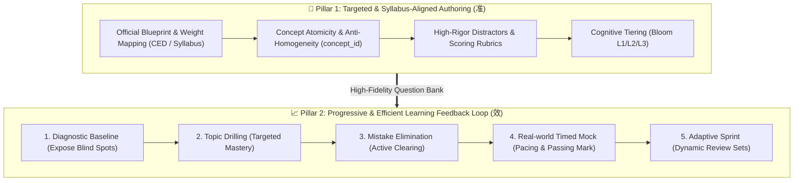
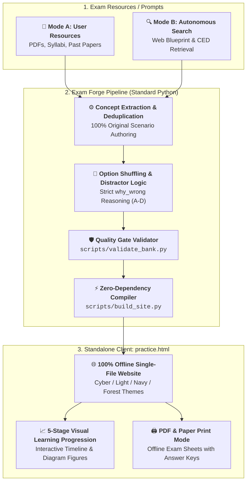

# Exam Forge — System Design & Architecture (系统设计与架构文档)

[English](DESIGN.md) | [简体中文](GUIDE.md)

This document details the architectural principles, cognitive learning models, synthesis pipeline, and client-side runtime of **Exam Forge**.

---

## 1. Core Design Philosophy: The Two Pillars (核心双核架构)

Exam Forge is fundamentally engineered around two interdependent pillars: **Authoring Authenticity ("准")** and **Progressive Cognitive Mastery ("效")**.



### Pillar 1: Authoring Authenticity & Syllabus Precision ("准")
1. **Curriculum Weight Calibration:**
   - Instead of generating questions randomly, the engine analyzes official examination specifications (e.g., College Board CED, DECA Guide, AWS Exam Guides, AMC syllabi).
   - Domain percentages (e.g., Domain A: 30%, Domain B: 40%, Domain C: 30%) determine the precise quota of questions authored per topic.
2. **Concept Atomicity (`concept_id`):**
   - Each problem is tagged with an atomic `concept_id` representing a distinct, non-fungible syllabus skill.
   - Prevents AI hallucination and repetitive numerical clones (e.g., 50 questions that merely change numbers in the same formula).
3. **Cognitive Tiering (Bloom's Taxonomy):**
   - **Difficulty 1 (Recall & Definition):** Fundamental terms, core theorems, baseline assumptions.
   - **Difficulty 2 (Application & Calculation):** Multi-step problem solving, quantitative evaluations, scenario diagnosis.
   - **Difficulty 3 (Synthesis & Edge-Case Traps):** Boundary conditions, cross-topic integration, counter-intuitive distractor reasoning.
4. **Distractor Rigor & Open-Ended Rubrics:**
   - Every multiple-choice distractor provides explicit diagnostic explanations (`why_wrong_en/zh`) pinpointing the underlying misconception (sign inversion, formula misuse, misread constraints).
   - Short-answer questions (`type: "short"`) include canonical reference answers (`answer_en/zh`) and structured rubrics (`rubric_en/zh`) for self-evaluation.

---

### Pillar 2: Progressive Mastery & Closed-Loop Efficiency ("效")

Rather than forcing learners into repetitive, static full-length mocks, Exam Forge implements a progressive 5-stage mastery framework:

```mermaid
flowchart LR
  classDef stage fill:#1e293b,stroke:#38bdf8,stroke-width:2px,color:#f8fafc;
  classDef goal fill:#0f172a,stroke:#10b981,stroke-width:2.5px,color:#34d399;

  S1["🎯 <b>Stage 1: Diagnostic</b><br/>Stratified Baseline Sample"]:::stage
  S2["📚 <b>Stage 2: Topic Drill</b><br/>Domain Deep-Dive"]:::stage
  S3["🔥 <b>Stage 3: Mistake Killer</b><br/>Dynamic Pitfall Elimination"]:::stage
  S4["⏱️ <b>Stage 4: Timed Mock</b><br/>Official Countdown & Benchmark"]:::stage
  S5["🏆 <b>Stage 5: Adaptive Sprint</b><br/>Targeted Score Booster"]:::goal

  S1 -->|Weaknesses Identified| S2
  S2 -->|Error Patterns Captured| S3
  S3 -->|Mistakes Cleared| S4
  S4 -->|Benchmark Assessed| S5
```



1. **Stage 1 (Diagnostic Baseline):** Stratified sampling across all curriculum domains to map baseline competency without time pressure.
2. **Stage 2 (Topic Competency Drilling):** Laser-focused practice on selected domains with instant bilingual explanations and distractor reasoning.
3. **Stage 3 (Targeted Mistake Elimination):** Dynamic error queue prioritizing recurring misconceptions. Items remain in the mistake pool until mastered consecutively.
4. **Stage 4 (Real-world Timed Simulation):** Strict exam countdown and full question volume. Evaluated against official passing thresholds (e.g., 75% benchmark) with accidental refresh recovery.
5. **Stage 5 (Adaptive Sprint to Certification):** Synthesizes optimized practice sets dynamically weighted:
   - **60% Weak Domains:** Concentrated practice on areas with the lowest accuracy.
   - **25% Unattempted Items:** Fresh problems to eliminate blind spots.
   - **15% Spaced Retention:** Spaced review of previously answered items to prevent memory decay.

---

## 2. Pipeline & Workflow Architecture (管线架构与工作流)




### Dual Operating Modes
- **Mode A (Resource-Guided):** Ingests raw inputs (PDFs, study notes, past papers), extracts core competencies, deduplicates knowledge points, and formats items into bilingual JSON.
- **Mode B (Autonomous Search & Redesign):** Triggered when no question bank is provided. The agent searches official authority portals, extracts the curriculum blueprint, and synthesizes 100% original, copyright-compliant scenario questions adhering to official domain weights.

---

## 3. Client-Side Runtime & State Machine (离线运行时设计)

### Zero-Dependency Architecture
The output `practice.html` is a standalone, single-file application requiring zero external network requests, CDNs, or server infrastructure.

```text
┌────────────────────────────────────────────────────────┐
│ practice.html (Standalone Client)                      │
│                                                        │
│  ┌─────────────────┐  ┌─────────────────┐              │
│  │ Embedded JSON   │  │ Math & Code     │              │
│  │ (Bank & Profile)│  │ Parser Engine   │              │
│  └─────────────────┘  └─────────────────┘              │
│  ┌─────────────────┐  ┌─────────────────┐              │
│  │ 5-Stage Adaptive│  │ Timed Mock      │              │
│  │ Engine          │  │ Session Recovery│              │
│  └─────────────────┘  └─────────────────┘              │
│  ┌─────────────────┐  ┌─────────────────┐              │
│  │ LocalStorage    │  │ @media print    │              │
│  │ State Sync      │  │ Paper Generator │              │
│  └─────────────────┘  └─────────────────┘              │
└────────────────────────────────────────────────────────┘
```

- **Offline Storage (`localStorage`):** Tracks question attempt histories, mistake banks, bookmarks (`⭐`), current stage, language preference (`en`/`zh`), and theme selection.
- **Crash Recovery (`sessionStorage`):** During timed mocks, question order, elapsed time, and entered answers are mirrored every second. Browser crashes or accidental page reloads restore the active mock state seamlessly.
- **Formula & Code Engine:** Native regex-based LaTeX parser supporting `$inline$` and `$$block$$` formulas without heavy external MathJax/KaTeX bundles. Code snippets support syntax indentation and dark-theme contrast.
- **Option Permutation:** When "Shuffle Choices" is enabled, options are randomized per question while preserving 1:1 mathematical alignment with the answer key and option-specific distractor explanations.

---

## 4. Quality Gates & System Guardrails (质量红线)

1. **Anti-Hallucination & Provenance:** Clearly demarcate original synthetic items from official practice materials. Never invent past-paper provenance.
2. **Concept Diversity Ratio:** Automated validator enforces a minimum unique `concept_id` count to prevent template redundancy.
3. **Bilingual Parity:** Both English and Chinese stems, choices, and explanations must maintain equivalent semantic fidelity and technical rigor.
4. **Data Privacy:** 100% local persistence ensures student study data and test scores never leave the local device.
