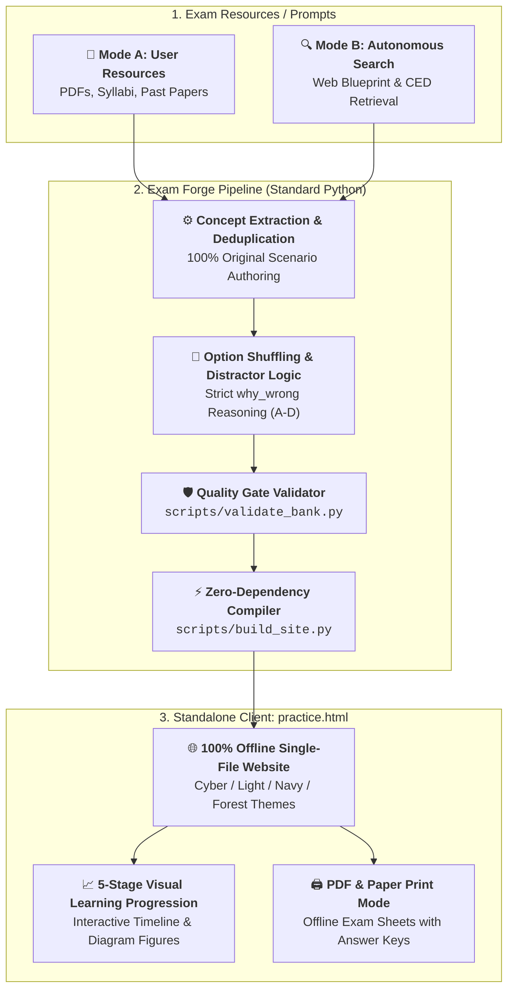

# Exam Forge — Adaptive Exam Practice Builder (Agent Skill)

[English](README.md) | [简体中文](README_zh.md)

> Turn user-provided exam resources **or** autonomous web research into a standalone, **bilingual adaptive practice website** with traceable questions, a 5-stage progressive mastery roadmap, realistic timed mocks, and a modern multi-theme UI.

**Zero external dependencies** — built purely with standard Python 3. Runs 100% offline with no CDNs, credentials, or web servers required.

---

## 🌟 Key Features

1. **Exam Profile & Target Metrics Integration**
   - Configures official exam identity, syllabus URLs, duration, passing score benchmark (e.g. 75%), target question bank capacity, and mock test quotas.
2. **5-Stage Progressive Mastery Journey (循序渐进体系)**
   - Replaces unstructured, repetitive drilling with a clear cognitive progression:  
     **Diagnostic Baseline ➔ Topic Competency Drilling ➔ Targeted Mistake Elimination ➔ Real-World Timed Mock ➔ Final Adaptive Sprint**.
   - Timed mocks benchmark performance directly against the passing line (**Benchmark Passed 🏆** vs. **Not Yet Met ⚠️**) with post-test diagnostic reviews.
3. **Multi-Theme UI & Dynamic SVG Exam Crest**
   - 4 built-in modern themes: **Cyber Dark**, **Academic Light**, **Midnight Navy**, and **Forest Green** (switchable instantly and persisted in `localStorage`).
   - Automatically generates a custom, high-resolution vector SVG crest/badge from the exam initials (e.g., `DECA`, `AMC`, `AP`, `MATH`).
4. **Math LaTeX & Programming Code Snippets**
   - Native lightweight Math rendering for inline (`$...$`) and block (`$$...$$`) formulas (e.g. $Q = \frac{FC}{P - VC}$, $E = mc^2$, quadratic roots), ideal for AMC, AP Calc, Physics, and Economics.
   - Syntax-formatted code containers (`` `code` `` and ```` ```python ... ``` ````) for AP Computer Science and technical certifications.
5. **Multi-Question Types & Anti-Memorization Choice Shuffling**
   - Supports Single Choice (`single`), Multiple Choice (`multiple`), and True/False (`boolean`).
   - Toggleable **🎲 Choice Shuffling**: randomizes option order while maintaining strict 1:1 synchronization with answer keys and **in-depth distractor explanations (`why_wrong_en/zh`)**.
6. **In-Depth Post-Mock Review & Distractor Breakdown**
   - Upon submitting a timed mock or completing a practice set, cards render all choices A–D, highlight your selection vs. the correct answer, and explain why each distractor is wrong.
7. **Exam Resilience, Bookmarking, & Paper Print Mode**
   - **Session Recovery**: Timed mock state auto-persists in `sessionStorage` against accidental browser refreshes.
   - **Key Items Bookmark (`⭐`)**: Bookmark tricky problems during practice or review to practice in a targeted folder.
   - **🖨️ Printable Paper Mode (`@media print`)**: Outputs clean paper exam sheets with candidate header and an answer key appendix for offline classrooms.
8. **Zero-Bank Autonomous Search & Redesign Pipeline (Mode B)**
   - When no past papers or files are supplied, the Agent autonomously retrieves official curriculum blueprints (e.g., College Board CED, DECA Guide), maps competency weights, and authors 100% original, copyright-compliant scenario problems up to the target quantity.

---

## 📈 5-Stage Progressive Learning Roadmap

```mermaid
flowchart LR
  classDef stage fill:#1e293b,stroke:#38bdf8,stroke-width:2px,color:#f8fafc;
  classDef goal fill:#0f172a,stroke:#10b981,stroke-width:2.5px,color:#34d399;

  S1["🎯 <b>Stage 1: Diagnostic</b><br/>Baseline Stratified Sample"]:::stage
  S2["📚 <b>Stage 2: Topic Drill</b><br/>Domain Deep-Dive"]:::stage
  S3["🔥 <b>Stage 3: Mistake Killer</b><br/>Bayesian Zero Pitfalls"]:::stage
  S4["⏱️ <b>Stage 4: Timed Mock</b><br/>Official Time & Pass Line"]:::stage
  S5["🏆 <b>Stage 5: Adaptive Sprint</b><br/>Certification Mastery"]:::goal

  S1 -->|Baseline detected| S2
  S2 -->|Pitfalls logged| S3
  S3 -->|Mistakes resolved| S4
  S4 -->|Benchmark verified| S5
```




1. **Stage 1 (Diagnostic Baseline):** Stratified sample across all topics to diagnose strengths and weaknesses.
2. **Stage 2 (Topic Competency Drilling):** Laser-focused domain training with bilingual stems, distractor reasoning, and visual diagram support.
3. **Stage 3 (Targeted Mistake Elimination):** Bayesian-smoothed review algorithm prioritizing recurrent misconceptions until cleared.
4. **Stage 4 (Real-world Timed Simulation):** Strict exam timer and full item load with Pass/Fail benchmark verdict and session auto-recovery.
5. **Stage 5 (Adaptive Sprint to Success):** Generates 5–10 personalized test sets (60% weak domains, 25% unattempted, 15% retention review).

### 💡 How to Practice: Step-by-Step vs. Flexible Study
- **Progressive Flow (Recommended):** Follow **Stage 01 ➔ 05** in sequence (Diagnostic → Domain Drills → Clear Mistakes → Timed Mock → Adaptive Sprint).
- **Flexible & Non-Locking:** Stages are **never locked**. Click any Stage card on the dashboard, select any domain from the sidebar, or jump straight into a timed mock anytime.
- **Two Distinct Experiences:**
  - **Daily Drills (Stages 1, 2, 3, 5):** Instant feedback after each question with complete A–D distractor rationale (`why_wrong`). Keyboard shortcuts: `A`–`D` or `1`–`4`.
  - **Timed Mock (Stage 4):** Official countdown timer, no answers revealed until submit, auto-saved against accidental refresh, followed by a Pass/Fail scorecard and tailored next steps.
- **Local & Private:** All records, bookmarks (`⭐`), and mistake banks save automatically to browser `localStorage` (100% offline & private). Use Export/Import to transfer data across devices.

---

## 🤖 Dual Operating Modes & Usage Workflow

> 📋 **Intake Survey on Invocation:** Whenever the skill is triggered, the Agent initiates an interactive survey to confirm your source mode, target question count, timer/passing benchmark, and format preferences. You can always click **Skip** (or tell the AI *"let AI decide"*) to let the Agent autonomously research official blueprints and apply optimal defaults.




### Mode A: User-Provided Resources
Use when you have PDFs, URLs, syllabi, or question documents.
> *"Use the exam-practice-builder skill to convert the attached exam PDFs into a bilingual adaptive study site. Curate distinct high-value concepts, generate distractor explanations for all options, and output practice.html."*

### Mode B: Autonomous Search & Redesign (Zero Initial Bank)
Use when you only have an exam title and a target question count.
> *"Use the exam-practice-builder skill to create a bilingual practice site for AP Microeconomics. I have no reference question bank: search the official College Board CED blueprint, author 30 original scenario questions covering Elasticity, Market Structures, and Factor Markets, configure a 60-minute timer and 75% benchmark, and compile practice.html."*

---

## 🚀 Quick Start

Requires only standard Python 3. Zero `pip install` required:

```bash
# 1. Validate question bank integrity and exam profile
python3 scripts/validate_bank.py examples/questions.json --profile examples/exam_profile.json

# 2. Build the single-file offline adaptive website
python3 scripts/build_site.py examples/questions.json --profile examples/exam_profile.json --out practice.html
```

Double-click `practice.html` in Chrome, Safari, or Edge to begin practicing immediately. All user learning progress is saved locally in browser `localStorage` and can be exported/imported as JSON.

---

## 📂 Project Structure

```text
exam_forge/
├── SKILL.md                  # Agent Skill definition and execution guardrails
├── GUIDE.md                  # Comprehensive operational manual & pedagogy guide
├── README.md                 # English documentation
├── README_zh.md              # 简体中文说明文档
├── scripts/
│   ├── validate_bank.py      # Schema, translation, deduplication, & profile validator
│   └── build_site.py         # Multi-theme single-file HTML website compiler
├── examples/
│   ├── exam_profile.json     # Exam metadata profile (benchmark template)
│   ├── questions.json        # Verified bilingual test bank with Math, Code, & distractors
│   └── resources.json        # External resource tracking & licensing configuration
└── practice.html             # Ready-to-use standalone offline mock testing portal
```

---

## 🛡️ Quality Gates & Principles

- **Anti-Hallucination & Provenance:** Never pretend an exam bank was read if it was not. Distinguish official materials from original synthetic items.
- **Genuine Concept Diversity:** Track `concept_id` vs `variant_of`. Never generate 100 questions from 5 repetitive templates.
- **Distractor Rigor:** Every single choice (A/B/C/D) must include clear explanations of why it fails or why it is correct.
- **True Portability:** Standalone HTML with zero network calls, preserving complete privacy on the student's device.
