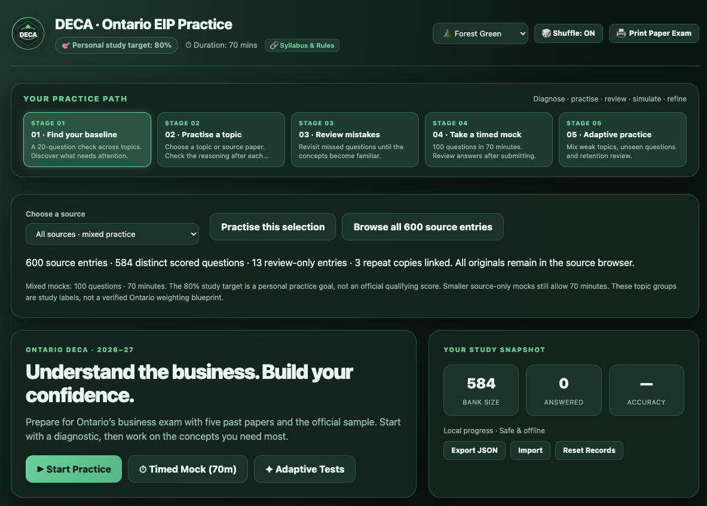

# Exam Forge — 考试通：自适应备考网站生成器 (Agent Skill)

[English](README.md) | [简体中文](README_zh.md) | [系统设计架构](DESIGN.md) | [使用指南手册](GUIDE.md)

> 将用户提供的考试资料或 AI 自动检索的官方考纲，转化为开箱即用、**中英双语的自适应刷题与模考网页系统**。具备高拟真度考题模拟、循序渐进五阶备考体系、现代多主题配色与专属动态考试徽标。

**零外部第三方依赖** — 纯 Python 3 标准库构建。生成的单文件 HTML 网页可在断网环境下 100% 离线使用，无须 CDN 或搭建任何服务器。

---

## 📸 运行效果预览 (System Preview)



*Exam Forge 生成的自适应练习系统实机效果：支持专属动态盾徽、多主题配色、知识模块雷达、LaTeX 数学公式排版与逐项选项深度错因剖析。*

---

## 🎯 核心设计哲学：两大支柱

Exam Forge 的核心架构围绕两个基本准则展开（详见 [DESIGN.md](DESIGN.md) 设计文档）：

1. **找准题目与考纲严密对齐（“准”）**
   - **大纲权重精准对齐**：联网检索官方考纲（如 College Board CED、DECA Guide、AWS Blueprint），严格按官方各模块分值占比配题，杜绝偏科与盲目出题。
   - **概念颗粒度控制 (`concept_id`)**：每题绑定独立考点原子，杜绝换数字刷题的机械重复，保证题目覆盖面真实完整。
   - **全选项深度错因剖析**：不仅给出正确解析，更对每个错误选项（A-D）剖析认知陷阱（`why_wrong_en/zh`）；问答题配齐标准踩分点（`rubric`）。

2. **循序渐进的高效复习改进（“效”）**
   - **五阶学习进阶阶梯**：引导考生按 **阶段一 摸底诊断 ➔ 阶段二 专题精练 ➔ 阶段三 错题清零 ➔ 阶段四 全真限时模考 ➔ 阶段五 考前冲刺达标** 科学跃迁。
   - **自适应动态组卷**：算法结合考生本地做题轨迹，动态生成提分卷（60% 薄弱章节 + 25% 新题 + 15% 巩固防遗忘）。
   - **本地离线与隐私安全**：作答轨迹、收藏星标（`⭐`）与错题本 100% 保存在浏览器 `localStorage`，支持模考防刷新意外恢复与 JSON 导出迁移。

---

## 🌟 核心特性亮点

- ⏱️ **全真限时模考：** 官方时长倒计时、及格基准线判定（如 75% 判定合格 🏆 vs 尚未达标 ⚠️）与防意外刷新恢复机制。
- 📐 **LaTeX 公式与代码块原生排版：** 原生支持行内公式 (`$...$`) 与块级公式 (`$$...$$`)，支持等宽代码块高亮，契合 STEM、经济学与计算机学科。
- 📝 **多题型全面支持：** 原生支持单选 (`single`)、多选 (`multiple`)、判断 (`boolean`)、客观填空/数值 (`fill`) 与问答自评 (`short`) 5 大题型。
- 🎲 **防死记选项动态乱序：** 打乱选项顺序的同时，与答案及各选项错因分析保持 1:1 精准重映射。
- 🎨 **四套现代主题与动态徽标：** 内置赛博深色、学院浅色、午夜深蓝、护眼森绿主题，并根据考试名称生成专属发光矢量盾徽。
- 🖨️ **纸质试卷打印模式 (`@media print`)：** 一键生成带考生署名栏与卷尾参考答案/解析附录的标准纸质试卷，支持线下模考。

---

## 🚀 快速上手 (Quick Start)

只需系统自带 Python 3，无需执行任何 `pip install`：

```bash
# 1. 校验题库完整性与考试档案
python3 scripts/validate_bank.py examples/questions.json --profile examples/exam_profile.json

# 2. 编译生成单文件离线自适应网站
python3 scripts/build_site.py examples/questions.json --profile examples/exam_profile.json --out practice.html
```

在 Chrome、Safari 或 Edge 等现代浏览器双击打开生成的 `practice.html` 即可立即开始做题。

---

## 🤖 双运行模式

- **模式 A：已有材料导入 (Resource-Guided)** — 传入真题 PDF、样卷、复习笔记，AI 提炼考点并生成双语练习站。
- **模式 B：零题库自主检索重构 (Autonomous Search & Redesign)** — 仅需提供考试名称，AI 联网检索官方考纲标准，原创同构 scenario 试题。

---

## 📂 项目文件结构

```text
exam_forge/
├── SKILL.md                  # Agent Skill 核心定义与质量红线约束
├── DESIGN.md                 # 系统架构设计与五阶学习认知模型文档
├── GUIDE.md                  # 详细使用指南与命题实操手册
├── README.md                 # 英文说明文档
├── README_zh.md              # 简体中文说明文档
├── scripts/
│   ├── validate_bank.py      # 题库格式、双语对称、查重与 Profile 校验器
│   ├── merge_bank.py         # 大题库分批生成合并与自动去重脚本
│   └── build_site.py         # 多主题、动态徽标的单文件 HTML 网页编译器
├── examples/
│   ├── exam_profile.json     # 考试元数据档案模板（标准基准示例）
│   ├── questions.json        # 经严格校验含公式、代码、多选题型的高质量题库范例
│   └── resources.json        # 外部考资追踪与授权记录
├── assets/
│   ├── snapshot.png          # 实机运行效果预览截图
│   ├── roadmap.svg           # 五阶学习路线图矢量资源
│   └── workflow.svg          # 系统工作流架构图矢量资源
└── practice.html             # 编译生成的单文件离线自适应练习网站
```

---

## 📖 深入阅读与参考

- [系统设计与架构文档 (DESIGN.md)](DESIGN.md) — 了解认知模型算法、双核设计哲学与单文件客户端架构。
- [完整使用指南手册 (GUIDE.md)](GUIDE.md) — 查看需求调研流程、题库 JSON 字段规范与出题实战技巧。
- [Agent Skill 技能规范 (SKILL.md)](SKILL.md) — 查看 AI Agent 执行该技能时的 Prompt 与质量门禁守则。
