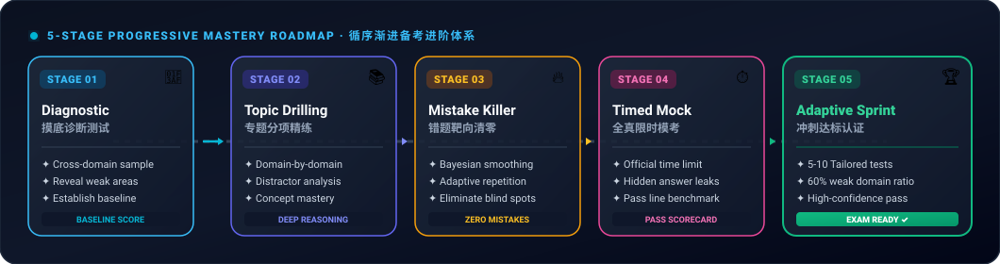
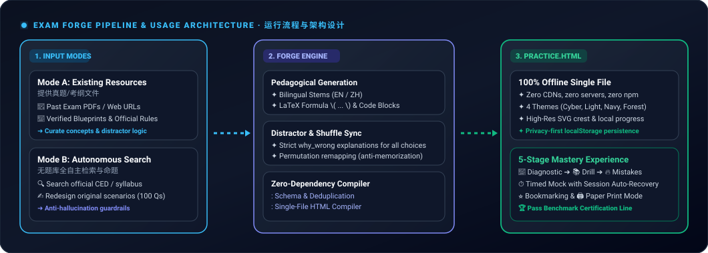
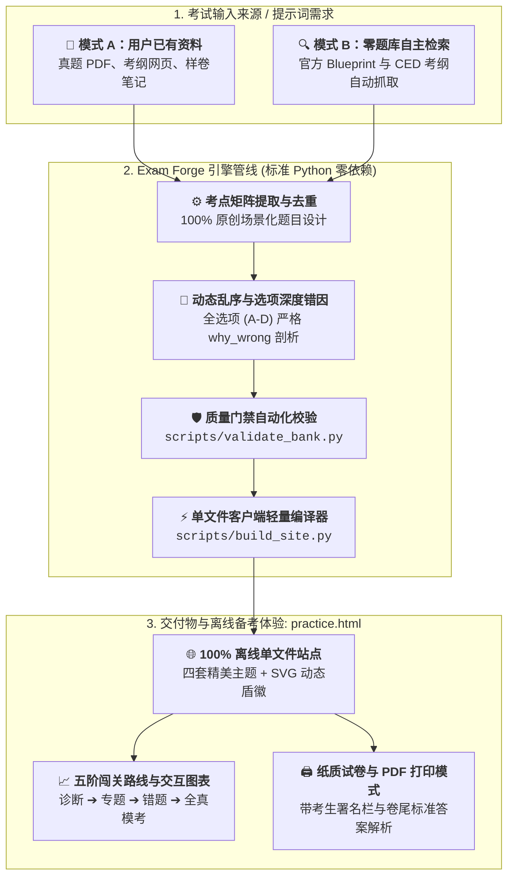

# Exam Forge — 考试通：自适应备考网站生成器 (Agent Skill)

[English](README.md) | [简体中文](README_zh.md)

> 将用户提供的考试资料或 AI 自动检索的官方考纲，转化为开箱即用、**中英双语的自适应刷题与模考网页系统**。具备高拟真度考题模拟、循序渐进五阶备考体系、现代多主题配色与专属动态考试徽标。

**零外部第三方依赖** — 纯 Python 3 标准库构建。生成的单文件 HTML 网页可在断网环境下 100% 离线使用，无须 CDN 或搭建任何服务器。

---

## 🌟 核心特性 (Key Features)

1. **考试元数据档案 (Exam Profile)**
   - 完整记录考试全称、考纲直达 URL、正式考试限时、官方及格达标线（如 75%）、目标规划题量与自适应模考套数。
2. **循序渐进的五阶备考进阶体系 (5-Stage Mastery Journey)**
   - 拒绝单一枯燥的盲目刷题，提供科学的能力跃迁阶梯：  
     **阶段一 摸底诊断 ➔ 阶段二 专题精练 ➔ 阶段三 错题清零 ➔ 阶段四 全真限时模考 ➔ 阶段五 考前冲刺达标**。
   - 限时模考根据及格线自动生成评估报告（**考核达标 🏆** vs **尚未达标 ⚠️**），并提供考后深度复盘。
3. **多主题切换与专属矢量考试徽标 (Multi-Theme & SVG Exam Crest)**
   - 内置 4 款现代主题风格：**Cyber Dark (赛博深色)**、**Academic Light (学院浅色)**、**Midnight Navy (午夜深蓝)** 与 **Forest Green (护眼森绿)**，支持右上角一键无缝切换并记忆在本地。
   - 根据考试简称（如 `DECA`、`AMC`、`AP`、`MATH`）自动生成专属高精度发光 SVG 勋章盾徽。
4. **LaTeX 数学公式与编程代码块原生排版**
   - 原生支持行内公式 (`$...$`) 与块级公式 (`$$...$$`)，如 $Q = \frac{FC}{P - VC}$、$E=mc^2$ 等，适用于 AMC、AP 微积分/物理/宏微观经济学。
   - 支持等宽代码块（`` `code` `` 和 ```` ```python ... ``` ````），适用于 AP Computer Science 及编程类专业认证。
5. **多题型支持与动态防死记乱序机制**
   - 支持单选题 (`single`)、多选题 (`multiple`)、判断题 (`boolean`)。
   - 提供 **🎲 选项动态乱序 (Shuffle Choices)** 开关：打乱选项顺序的同时，与正确答案及**每个选项的深度错因剖析（`why_wrong_en/zh`）**保持严格 1:1 精准重映射，彻底杜绝死记选项位置。
6. **深度考后全卷复盘与错因剖析 (Comprehensive Review)**
   - 模考交卷或综合练习完成后，卡片完整呈现所有选项 A–D，清晰标出考生作答与正确选项对比，并展开每个干扰项的深度错因剖析。
7. **模考防刷新自恢复、重点收藏与纸质打印 (Paper Exam Print)**
   - **防意外刷新 (Session Recovery)**：限时模考作答状态实时持久化于 `sessionStorage`，意外刷新页面可一键恢复作答进度。
   - **重点题目收藏夹 (`⭐`)**：做题与复盘时随时标记难点重点，可在侧边栏进入专属收藏夹靶向攻坚。
   - **🖨️ 纸质试卷打印模式 (`@media print`)**：一键生成带考生署名栏与卷尾参考答案/解析附录的标准纸质试卷，支持另存为 PDF 或线下打印。
8. **零题库自主检索与原创重构链路 (Mode B)**
   - 当用户不提供任何现成题目或文件时，Agent 会自主联网检索官方考纲（如 College Board CED、DECA Guide），按各模块分值权重拆解微知识点矩阵，靶向原创命制符合布鲁姆认知层级的 100% 合规情境考题。

---

## 📈 五阶循序渐进备考体系 (5-Stage Roadmap)




1. **阶段一（摸底诊断）：** 跨知识模块分层抽样，测出初始知识短板与基准掌握度。
2. **阶段二（专题精练）：** 针对特定薄弱模块靶向训练，结合双语解析、图表直观展示与错因剖析吃透考点。
3. **阶段三（错题清零）：** 贝叶斯平滑算法动态加权，优先推送高频混淆题，直至错题本清零。
4. **阶段四（全真模考）：** 官方限时倒计时与全量题量仿真，具备作答防刷新自恢复，并对比及格基准线给出 Pass/Fail 判定。
5. **阶段五（冲刺达标）：** 生成 5–10 套自适应套卷（60% 薄弱模块 + 25% 未见题 + 15% 巩固复习）。

### 💡 做题指南：阶段闯关还是自由刷题？
- **循序渐进闯关（推荐）：** 按 **Stage 01 ➔ 05** 顺序推进（摸底诊断 ➔ 专题精练 ➔ 错题清零 ➔ 全真模考 ➔ 自适应冲刺）。
- **完全自由不锁死：** 各阶段**不设前置锁死条件**。可随时点击首页任意 Stage 卡片、点击左侧考点单独补弱，或直接开启全真模考。
- **两种做题体验：**
  - **日常练习（阶段 1、2、3、5）：** 每做一题即时核对，展示详尽中英解析与 **A-D 逐项错因剖析**；支持键盘 `A`–`D` 或 `1`–`4` 快捷作答。
  - **全真模考（阶段 4）：** 官方时限倒计时，中途不泄露答案，支持防刷新意外恢复；提交后自动判定及格线并推荐下一步补弱方向。
- **数据自动沉淀：** 所有做题记录、收藏星标（`⭐`）与错题本实时保存在本地浏览器 `localStorage`，离线安全，支持 JSON 导出与跨设备迁移。

---

## 🤖 双运行模式与使用流程架构 (Usage Workflow)

> 📋 **智能前置调研问卷：** 每次调用该 skill 时，AI 均会发起一个交互式问卷对齐需求。你可以直接点击 **「Skip / 跳过」**，或者在给出考试主题后选择 **“跳过剩余所有问题”**——AI 将自动联网检索官方考纲，对未指定的参数全自动应用官方标准智能决策。





### 模式 A：用户提供资料 (Resource-Guided)
适用于手头有 PDF、样卷、大纲文档或网页链接时：
> *“使用 exam-practice-builder 技能，将附件的考试 PDF 转为中英双语自适应练习网站。提炼高价值独立考点，为每个选项生成错因分析，输出 practice.html。”*

### 模式 B：零题库自主搜索重构 (Autonomous Search & Redesign)
适用于手里没有现成题库，仅有考试名称和目标题量时：
> *“使用 exam-practice-builder 技能，为我制作 AP 微观经济学线上练习站。我手里没有参考题库：请联网搜索官方 College Board CED 考纲分值比例，原创重构 30 道涵盖供需弹性、市场结构和要素市场的深度情境题，配置 60 分钟倒计时与 75% 及格线，生成 practice.html。”*

---

## 🚀 快速开始 (Quick Start)

只需系统自带 Python 3，无需执行任何 `pip install`：

```bash
# 1. 校验题库完整性与考试档案
python3 scripts/validate_bank.py examples/questions.json --profile examples/exam_profile.json

# 2. 编译生成单文件离线自适应网站
python3 scripts/build_site.py examples/questions.json --profile examples/exam_profile.json --out practice.html
```

在 Chrome、Safari 或 Edge 等现代浏览器双击打开生成的 `practice.html` 即可立即开始做题。学习记录完全保存在本地 `localStorage`，支持 JSON 导入/导出跨设备迁移。

---

## 📂 项目文件结构

```text
exam_forge/
├── SKILL.md                  # Agent Skill 核心定义与质量红线约束
├── GUIDE.md                  # 详细使用指南与备考进阶方法论手册
├── README.md                 # 英文说明文档
├── README_zh.md              # 简体中文说明文档
├── scripts/
│   ├── validate_bank.py      # 题库格式、双语对称、查重与 Profile 校验器
│   └── build_site.py         # 多主题、动态徽标的单文件 HTML 网页编译器
├── examples/
│   ├── exam_profile.json     # 考试元数据档案模板（标准基准示例）
│   ├── questions.json        # 经严格校验含公式、代码、多选、判断题的高质量题库范例
│   └── resources.json        # 外部考资追踪与授权记录
└── practice.html             # 生成的开箱即用单文件离线模拟考试网站
```

---

## 🛡️ 质量关卡与红线守则

- **严禁编造与真实溯源：** 严禁宣称阅读了未实际获取的题库，严禁捏造真题出处；严格区分官方材料与原创同构题。
- **杜绝低质模板刷量：** 严格追踪 `concept_id` 与 `variant_of`，绝不拿 5 个模板换数字粗制滥造 100 道水题。
- **逐项错因深度剖析：** 每个选项必须有充分的中英双语错因分析（`why_wrong_en/zh`），解释为什么错、错在何处。
- **纯粹的离线与隐私安全：** 单文件 HTML 不包含任何外部网络请求或 CDN，学习进度仅保留在学生设备本地。
